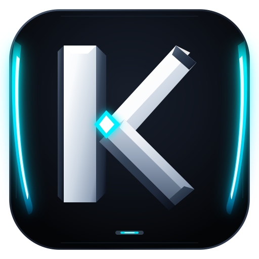

<p align="center">
  
</p>

<h1 align="center">Kronos</h1>

<p align="center">
  <a href="README.md">English</a> ·
  <a href="README.zh-CN.md">简体中文</a> ·
  <a href="README.ja.md">日本語</a> ·
  <a href="README.ko.md">한국어</a>
</p>

<p align="center">
  <a href="https://github.com/Xenonesis/Kronos/stargazers">
    
  </a>
  <a href="https://github.com/Xenonesis/Kronos/releases">
    
  </a>
  <a href="https://xenonesis.github.io/Kronos/">
    
  </a>
</p>

<p align="center">The Apex AI Developer Workstation & Autonomous Agent Swarm Engine.<br>Native Rust Tauri v2 compositor under 100MB RAM. Zero Electron bloat.</p>
<p align="center">
  
</p>

<p align="center">
  
</p>

Kronos is a high-performance native AI developer workstation and autonomous agent swarm execution engine built with Tauri v2 and native Rust. For agent-driven engineering, it provides a high-density tactical cockpit: run autonomous coding swarms, edit files, review AST diffs, run tests in sandboxed terminals, and inspect live web applications through headless browser automation.

- **Apex Rust Architecture:** Built on Tauri v2 linking directly to native OS WebView2 (<100MB RAM, sub-second cold boot, 0% Chromium bloat).
- **Parallel swarms:** Run multiple agents concurrently, each isolated in its own git worktree.
- **OMP Sessions Timeline:** Frame-accurate telemetry into subagent state trees, tool dispatch payloads, AST diff artifacts, and deterministic rollback points.
- **Headless Browser Automation:** Live DOM inspection, click coordinate targeting, screenshot capture, and cookie vault synchronization.
- **Complete engineering cockpit:** Integrated editors, visual diff inspectors, pull request management, and embedded terminal grids.
- **1-Click Self-Updating Setup:** Instant local atomic compilation and persistent release packaging via `update-desktop-exe.bat`.
- **Multi-provider:** Claude Code, Codex, GitHub Copilot, OpenCode, Pi, Antigravity, Muse Code, and OMP through a unified interface.
- **Air-gapped & Privacy-First:** 100% localhost execution with zero telemetry, zero surveillance, and no forced logins.

[Visit the Kronos Telemetry Site](https://xenonesis.github.io/Kronos/) · [Download Windows Installer](https://github.com/Xenonesis/Kronos/releases/latest/download/Kronos_x64-setup.exe)

## Sponsors

<!-- Sponsors: one cell per sponsor in the order of packages/website/src/data/sponsors.ts, then "become a sponsor" cells up to three. -->
<table>
  <tr>
    <td align="center" width="33%"><a href="https://hoplite.sh/?utm_source=paseo&utm_medium=readme&utm_campaign=sponsor"><picture><source media="(prefers-color-scheme: dark)" srcset="packages/website/public/sponsors/hoplite-on-dark.svg"></picture></a><br><sub>Cloud coding agents</sub></td>
    <td align="center" width="33%"><a href="https://paseo.sh/sponsor">Become a sponsor</a></td>
    <td align="center" width="33%"><a href="https://paseo.sh/sponsor">Become a sponsor</a></td>
  </tr>
</table>

## Plugins

Plugins run on the daemon and show up in every client you connect, with the same UI on desktop, web,
iOS, and Android. Write a plugin once and it is on your phone.

- **UI:** screens, sidebar items, workspace panels, Command Center items, slash commands, composer pills, attachment sources, timeline items, themes.
- **Agent lifecycle:** change configuration, environment, and MCP servers, answer permissions, follow up when a turn ends.
- **Providers:** add a coding agent as a provider.

Install from the registry with `paseo plugin add owner/slug`, or from Git or a local directory.

**[Browse plugins](https://paseo.sh/plugins)** · **[Plugin docs](https://paseo.sh/docs/plugins)**

Plugins run with access to your daemon machine and inside connected clients; install only code you trust.

## Getting Started

Kronos runs a lightweight local background daemon managing your coding agents. The native Tauri v2 desktop workstation connects to it automatically over localhost WebSocket.

### Prerequisites

You need at least one agent CLI installed and configured with your credentials:

- [Claude Code](https://docs.anthropic.com/en/docs/claude-code)
- [Codex](https://github.com/openai/codex)
- [GitHub Copilot](https://github.com/features/copilot/cli/)
- [OpenCode](https://github.com/anomalyco/opencode)
- [Pi](https://pi.dev)
- [Antigravity](https://paseo.sh/docs/supported-providers#antigravity)
- [Muse Code](https://paseo.sh/docs/muse-code)

### Desktop Workstation (Recommended)

Download the persistent production installer (`Kronos_x64-setup.exe`) from the [GitHub Releases page](https://github.com/Xenonesis/Kronos/releases/latest/download/Kronos_x64-setup.exe) or visit the [Kronos site](https://xenonesis.github.io/Kronos/). Opening the workstation automatically boots the local daemon.

To rebuild or update locally at any time:

```cmd
.\update-desktop-exe.bat
```

### Server

For a server, a VM, or any machine without the desktop app. Install the CLI and start the daemon:

```bash
npm install -g @getpaseo/cli
paseo
```

Paseo starts, then asks whether to enable the end-to-end encrypted relay for device pairing. If you decline, connect directly over TCP, Tailscale, or another VPN. The desktop, mobile, and web apps connect to this daemon like any other host.

For full setup and configuration, see:

- [Docs](https://paseo.sh/docs)
- [Connectivity guide](https://paseo.sh/docs/connectivity)
- [Configuration reference](https://paseo.sh/docs/configuration)

### Docker

Run the Paseo daemon and self-hosted web UI in Docker:

```bash
docker run -d --name paseo \
  -p 6767:6767 \
  -e PASEO_PASSWORD=change-me \
  -v "$PWD/paseo-home:/home/paseo" \
  -v "$PWD:/workspace" \
  ghcr.io/getpaseo/paseo:latest
```

Open `http://localhost:6767` after it starts. Extend the base image with the agent CLIs you use, then provide credentials through environment variables or the persistent `/home/paseo` volume. See the [Docker documentation](docs/docker.md) for full setup details.

## CLI

Everything you can do in the app, you can do from the terminal.

```bash
paseo run --provider claude/opus-4.6 "implement user authentication"
paseo run --provider codex/gpt-5.5 --worktree feature-x "implement feature X"

paseo ls                           # list running agents
paseo attach abc123                # stream live output
paseo send abc123 "also add tests" # follow-up task

# run on a remote daemon; --cwd is a path on that host
paseo run --host workstation.local:6767 --cwd /workspace "run the full test suite"
```

See the [full CLI reference](https://paseo.sh/docs/cli) for more.

## TypeScript SDK

Build issue integrations, dashboards, and orchestration services with `@getpaseo/client`:

```ts
import { createPaseoClient } from "@getpaseo/client";

const client = createPaseoClient({ url: "ws://127.0.0.1:6767/ws" });
await client.connect();

const agent = await client.agents.create({
  config: { provider: "codex/gpt-5.5" },
  cwd: "/Users/me/dev/storefront",
  prompt: "Review the current diff and name the riskiest change.",
});

const result = await agent.waitForFinish();
console.log(result.lastMessage);

await client.close();
```

See the [SDK quickstart](https://paseo.sh/docs/sdk/quickstart), [recipes](https://paseo.sh/docs/sdk/recipes), and [API reference](https://paseo.sh/docs/sdk/reference).

## Skills

Skills teach your agent to use Paseo to orchestrate other agents.

```bash
npx skills add getpaseo/paseo
```

Then use them in any agent conversation:

- `/paseo-handoff` — hand off work between agents. I use this to plan with Claude and then handoff to Codex to implement.
- `/paseo-advisor` — spin up a single agent as an advisor for a second opinion, without delegating the work itself.
- `/paseo-committee` — form a committee of two contrasting agents to step back, do root cause analysis, and produce a plan.

## Development

Quick monorepo package map:

- `packages/desktop-tauri`: Native Rust Tauri v2 desktop workstation (<100MB RAM, custom tactical titlebar, system tray, auto-updater)
- `packages/server`: Kronos daemon (agent process orchestration, WebSocket API, MCP server, Playwright automation)
- `packages/app`: React UI client (Expo / Web / Desktop)
- `packages/cli`: `paseo` CLI for daemon and agent workflows
- `packages/relay`: Relay transport and encryption used by the daemon and clients
- `packages/website`: Tactical telemetry marketing site and documentation

Common commands:

```bash
# run all local dev services
npm run dev

# run individual surfaces
npm run dev:server
npm run dev:app
npm run dev:desktop
npm run dev:website

# build the server stack
npm run build:server

# repo-wide checks
npm run typecheck
```

## Support Paseo

Paseo is an independent project used by tens of thousands of developers daily, built by one person and funded by the people who use it. Support the work on [GitHub Sponsors](https://github.com/sponsors/boudra). Companies can [sponsor Paseo](https://paseo.sh/sponsor#spot) monthly and have their logo shown at the top of this README and on the paseo.sh homepage and docs.

## Related projects

- [getpaseo/paseo-relay](https://github.com/getpaseo/paseo-relay) — official distributed relay, written in Elixir
- [paseo-vscode](https://marketplace.visualstudio.com/items?itemName=hinnes.paseo-vscode) — VS Code extension

## License

Apache-2.0
