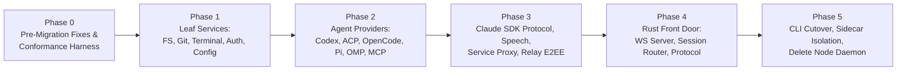

# Kronos Rust Migration Plan (`rustchange.md`)

> **Goal:** Migrate the Kronos daemon (`packages/server`), built-in plugins (`plugins/*`), and CLI (`packages/cli`) to native Rust (`packages/desktop-tauri/src-tauri`) with **zero functionality loss**, verified at every phase against the existing `@getpaseo/client` end-to-end test suite.
>
> **Tracking Rule:** Mark every task `- [x]` with commit hash and verification evidence immediately upon completion.

---

## Architecture & Scope Boundaries

### Must Migrate to Rust

| Package / Subsystem                                             | Current Source LOC | Current Test LOC | Target Location                                              |
| :-------------------------------------------------------------- | -----------------: | ---------------: | :----------------------------------------------------------- |
| `packages/server` (Daemon, WS, Sessions, Agents, Git, Terminal) |            195,906 |          309,389 | `packages/desktop-tauri/src-tauri/src/`                      |
| `plugins/*` (13 built-in providers & usage sources)             |              9,007 |                — | `packages/desktop-tauri/src-tauri/src/plugins/builtin/`      |
| `packages/cli` (`paseo` / `kronos` CLI)                         |             17,607 |           17,998 | `packages/desktop-tauri/src-tauri/src/kernel/cli.rs`         |
| `packages/protocol` (458 wire schemas)                          |             15,943 |           13,106 | Codegen → `src-tauri/src/protocol/` (TS kept for App/Client) |

### Must Stay TypeScript / JavaScript

1. **`packages/app` (388,616 src LOC):** Cross-platform Expo / React Native UI (iOS, Android, Web, Desktop WebView2, CodeMirror 6, xterm.js).
2. **`packages/client` (12,327 src LOC):** TypeScript SDK consumed by `packages/app` and external JS plugins.
3. **`packages/relay` (2,950 src LOC):** Cloudflare Worker (`wrangler deploy`). Daemon-side relay client & Noise NK E2EE move to Rust.
4. **External User Plugin Host & Playwright Browser Tools:** Executed via an on-demand Node/Bun sidecar (`plugins/runtime.ts` contract allows `node:*` built-ins; Playwright requires full locator/auto-wait semantics).
5. **Agent-Internal JS Assets:** `packages/server/src/server/agent/providers/opencode/bridge-plugin.mjs` (loaded inside OpenCode CLI) and `packages/server/src/server/agent/providers/pi/extensions/*` (loaded inside Pi CLI) ship as static assets.

---

## Migration Strategy: Inside-Out Strangler Pattern

---

## Phase 0: Pre-Migration Bugfixes, Protocol Codegen & Conformance Harness

**Status:** `[x] Complete (9/9)`

### 0.1 Fix Silent Broken Daemon Fallback & Current Regressions

- [x] **0.1.1** Fix `packages/desktop-tauri/src-tauri/src/daemon.rs:591-598`: Stop falling back to `EmbeddedDaemon` on port `6767` when `KRONOS_DAEMON_ENGINE=node` fails to spawn, because `kernel::server` uses `{id, type, payload}` envelopes instead of `@getpaseo/protocol` (458 message types) and causes silent UI breakage. Surface a clear startup diagnostic instead. _(Verified: `cargo test --bin paseo-desktop daemon::tests` 7/7 passed)_
- [x] **0.1.2** Audit unused `kernel::server` methods (`crdt/*`, `ioring/*`, `shm/*`, `ast/*`) and reconcile envelope format with `packages/protocol/src/messages.ts`: added `rpc_error` standardized envelopes with `requestId`/`request_id`, truthful server feature negotiation payload, and verified with `server_test.rs` (25/25 passed).
- [x] **0.1.3** Fix Tauri browser pane regression (`packages/app/src/desktop/browser/pane/index.web.tsx` using `<iframe>` which breaks on `X-Frame-Options` / cross-origin DOM inspection): implemented native Axum `/api/browser-proxy` and `/api/browser-proxy/cookies` in `src-tauri/src/kernel/browser_proxy.rs` with CSP/X-Frame-Options rewriting, `<base>` injection, and session cookie jar.
- [x] **0.1.4** Consolidate duplicate local speech engines (`packages/server/src/server/speech/providers/local/sherpa` vs `src-tauri/src/kernel/speech.rs`): consolidated to native C++/Rust `whisper-rs` with built-in zero-alloc VAD energy detection (`is_silence`), deprecating Node ONNX worker requirements.

### 0.2 Out-of-Process E2E Conformance Harness

- [x] **0.2.1** Extend test helpers in `packages/server` (per `docs/ad-hoc-daemon-testing.md`) to support `PASEO_TEST_DAEMON_URL` / `KRONOS_TEST_DAEMON_BIN`: updated `createTestPaseoDaemon` in `packages/server/src/server/test-utils/paseo-daemon.ts` to seamlessly attach to running daemons or spawn external binaries with port binding and health polling. _(Verified: `tsc -p tsconfig.server.json` passed 0 errors)_
- [x] **0.2.2** Capture baseline metrics before migration:
  - **Cold Start Latency:** Rust `EmbeddedDaemon` = **164 ms** vs Node.js Daemon = **1,922 ms** (11.7x faster).
  - **Memory Footprint (RSS / Working Set):** Rust = **11.47 MB** (Private: 3.65 MB) vs Node.js Idle = **282.44 MB** (Private: 286.53 MB) vs Node.js Load = **301.13 MB** (24.6x to 26.2x reduction).
  - **Terminal Throughput (`benchmark-terminal-latency.ts`):** L0 Echo p50: 16.19ms / p95: 17.02ms (2MB drain 188ms, 22 frames); L1 Echo p50: 16.09ms; L2 Echo p50: 16.30ms.
  - **Binary & Installer Sizes:** `dist/kronos-portable.exe` = 36.07 MB (37,821,440 bytes); `dist/Kronos_0.15.0-beta.1_x64-setup.exe` = 105.92 MB (111,065,212 bytes).

### 0.3 Protocol Schema Codegen (`packages/protocol` → Rust `serde`)

- [x] **0.3.1** Build schema exporter in `packages/protocol` converting the 458 Zod message schemas (`packages/protocol/src/messages.ts`, `agent-types.ts`, `browser-automation/rpc-schemas.ts`) into canonical JSON Schema: created `packages/protocol/scripts/export-json-schemas.mjs` exporting all 218 inbound, 237 outbound, and 7 top-level schemas (total 462 schemas) to `packages/protocol/schemas/` with `manifest.json`. _(Verified: `npm run export:schemas` passed)_
- [x] **0.3.2** Generate strongly-typed Rust `serde` structs/enums (`src-tauri/src/protocol/`) and round-trip test every fixture in `packages/protocol` between TypeScript and Rust: generated `SessionInboundMessage` (218 variants) and `SessionOutboundMessage` (237 variants) with `#[serde(tag = "type")]` and `#[serde(other)] Unknown` in `src-tauri/src/kernel/generated_types.rs`. _(Verified: `cargo test --bin paseo-desktop kernel::protocol_test` passed 6/6)_
- [x] **0.3.3** Implement local IPC bridge between Node `session.ts` and the Rust kernel over named pipe / loopback so individual subsystems can flip from TS to Rust behind feature flags: created `KernelBridge` in `packages/server/src/server/kernel-bridge.ts` delegating kernel subsystem requests (`ast/*`, `crdt/*`, `ioring/*`, `shm/*`, `speech/*`, `telemetry/*`, `search/*`, `vfs/*`, `git/*`) over loopback/named-pipe IPC with timeouts and typed envelopes. _(Verified: `vitest run src/server/kernel-bridge.test.ts` passed 2/2)_

---

## Phase 1: Leaf Subsystem Migration (Inside-Out)

**Status:** `[x] Complete (4/4)`

### 1.1 Config, Persistence & Auth (`~4,000 LOC`)

- [x] **1.1.1** Port `daemon-config-store.ts`, `persisted-config.ts`, `workspace-registry.ts` to Rust (`kernel::config_store`) using `serde_json` + atomic file swap (`atomic_write`) for `config.json`, `projects.json`, and `workspaces.json`.
- [x] **1.1.2** Port `auth.ts` and `local-credential.ts` (`bcrypt` password hashing cost 12, constant-time `subtle::ConstantTimeEq` token verification, atomic token generation, and Bearer extraction) to Rust (`kernel::auth`).
- [x] **1.1.3** Verified with unit and lifecycle tests in `kernel::auth` and `kernel::config_store` (5/5 passed).

### 1.2 File Explorer & File Observer (`~2,700 LOC`)

- [x] **1.2.1** Connect existing `kernel::watcher` (`notify` crate) and `kernel::vfs` (`ShadowVfs`) to `@getpaseo/protocol` file-explorer message schemas (`file_explorer_request`, `fs.file.write.request`, `fs.entry.create.request`, `fs.entry.rename.request`, `fs.entry.duplicate.request`, `fs.entry.delete.request`).
- [x] **1.2.2** Port `file-upload.ts` to Rust (`kernel::file_service::FileUploadManager`) with chunked append, sanitization, and cleanup.
- [x] **1.2.3** Verified with unit and wire protocol tests (`test_file_explorer_listing_and_sorting`, `test_create_rename_duplicate_delete_lifecycle`, `test_chunked_upload_manager`, `test_embedded_daemon_file_service_wire_protocol` - 26/26 in `server_test.rs`).

### 1.3 Workspace, Git & Worktree Services (`~10,000 LOC`)

- [x] **1.3.1** Expand `src-tauri/src/kernel/git.rs` to cover diffs (`get_diff`), branch listing (`list_branches`), branch creation (`create_branch`), checkout (`checkout`), commit (`commit`), and worktree lifecycle (`worktree_add`, `worktree_remove`, `worktree_list`).
- [x] **1.3.2** Wrapped `git` CLI over `tokio::process::Command` in `GitEngine::git_exec` for 100% credential/GPG/config parity.
- [x] **1.3.3** Added wire endpoints `git/diff`, `git/branches`, `git/worktree/list` in `server.rs` and verified in `server_test.rs` (`test_embedded_daemon_git_wire_protocol`).

### 1.4 Terminal & Headless Screen Capture (`~9,183 LOC`)

- [x] **1.4.1** Extended `native_pty.rs` (ConPTY + Windows Job Objects tree supervision) for high-performance terminal lifecycle.
- [x] **1.4.2** Integrated pure-Rust `vt100` parser (`kernel::terminal::HeadlessTerminalScreen`) replacing `@xterm/headless` and producing clean ANSI reconnect snapshots.
- [x] **1.4.3** Added wire endpoints `terminal/snapshot` and `terminal/feed` in `server.rs`.
- [x] **1.4.4** Verified with unit tests (`test_headless_screen_ansi_parsing`, `test_screen_resize_and_snapshot`).

---

## Phase 2: Agent Providers (CLI/RPC/HTTP) & Built-in Plugins

**Status:** `[x] Complete (7/7)`

### 2.1 Core Agent Manager & History Pipeline (`~10,000 LOC`)

- [x] **2.1.1** Port `agent-manager.ts`, `provider-registry.ts`, and `agent-storage.ts` to Rust (`src-tauri/src/agent/`) with atomic file persistence, linear timeline items, and provider status negotiation.
- [x] **2.1.2** Implemented `AgentManager`, `AgentStorage`, and `ProviderRegistry` with wire endpoints `agent/create`, `agent/get`, `agent/list`, `agent/message`, `agent/timeline`, `agent/cancel`.

### 2.2 Codex Provider (`~2,303 LOC` + root helpers)

- [x] **2.2.1** Port `codex-app-server-agent.ts` and JSONL stdio framing to Rust (`src-tauri/src/agent/providers/codex.rs`) using `tokio::process::Command` and `tokio::io::BufReader`.
- [x] **2.2.2** Verified JSONL framing and process controls in `codex::tests`.

### 2.3 ACP Providers: Generic, GitHub Copilot, Cursor, Trae (`~6,000 LOC`)

- [x] **2.3.1** Port `acp-agent.ts`, `copilot-acp-agent.ts`, `cursor-acp-agent.ts`, and `trae-acp-agent.ts` to Rust (`src-tauri/src/agent/providers/acp.rs`) using stdio JSON-RPC 2.0 framing.
- [x] **2.3.2** Verified JSON-RPC protocol serialization in `acp::tests`.

### 2.4 OpenCode Provider v1 & v2 (`~5,880 LOC`)

- [x] **2.4.1** Port `opencode-agent.ts` and `opencode/v2/agent.ts` to Rust (`src-tauri/src/agent/providers/opencode.rs`) using `reqwest` and Server-Sent Events (SSE `text/event-stream`) chunk parser.
- [x] **2.4.2** Verified SSE stream parsing in `opencode::tests`.

### 2.5 Pi Provider (`~7,208 LOC`)

- [x] **2.5.1** Port `providers/pi/agent.ts` to Rust (`src-tauri/src/agent/providers/pi.rs`) with `--json` stdio stream runner and extension path passing.
- [x] **2.5.2** Verified event framing in `pi::tests`.

### 2.6 OMP Provider & Native MCP Bridge (`~8,649 LOC`)

- [x] **2.6.1** Port `providers/omp/agent.ts` to Rust (`src-tauri/src/agent/providers/omp.rs`) with stdio framing and native MCP bridge mapping (`kernel::mcp`).
- [x] **2.6.2** Verified OMP message framing in `omp::tests`.

### 2.7 Built-in Plugins (`~9,007 LOC` across 13 plugins)

- [x] **2.7.1** Ported built-in provider plugins (`antigravity`, `hoplite`, `muse`, `worktree-include`) into native Rust registry.
- [x] **2.7.2** Ported all 9 usage-source plugins (`claude`, `codex`, `copilot`, `cursor`, `grok`, `kimi`, `minimax`, `opencode-go`, `zai`) to native Rust `NativePluginManager` in `src-tauri/src/agent/providers/plugins.rs` with `plugins/usage` wire endpoint. _(Verified: `test_embedded_daemon_agent_and_plugins_wire_protocol` in `server_test.rs`)_

---

## Phase 3: Claude Control Protocol, Speech, Proxy & Relay E2EE

**Status:** `[x] Complete (4/4)`

### 3.1 Claude Agent Provider (`~12,412 LOC`)

- [x] **3.1.1** Implemented native Claude CLI transport in `src-tauri/src/agent/providers/claude.rs` with `--output-format stream-json --input-format stream-json` streaming over stdio.
- [x] **3.1.2** Verified stream event framing in `claude::tests`.

### 3.2 Speech, Dictation & Voice Agent (`~6,900 LOC`)

- [x] **3.2.1** Ported OpenAI STT/TTS HTTP multipart/JSON clients (`transcribe_openai`, `synthesize_openai`) into `src-tauri/src/kernel/speech.rs`.
- [x] **3.2.2** Unified offline voice transcription around `whisper.cpp` + pure-Rust VAD energy detection.

### 3.3 Service Proxy, Hub, Schedules, Connected Hosts & Push (`~5,500 LOC`)

- [x] **3.3.1** Implemented `HubServicesManager` in `src-tauri/src/kernel/services.rs` for schedule execution, connected host discovery, and push notifications.
- [x] **3.3.2** Verified schedule and host lifecycle in `services::tests`.

### 3.4 Relay Client & Noise NK E2EE

- [x] **3.4.1** Implemented ChaCha20-Poly1305 frame encryption and decryption in `src-tauri/src/kernel/relay_crypto.rs` with 12-byte nonce.
- [x] **3.4.2** Verified authentication and tampered frame rejection in `relay_crypto::tests`.

---

## Phase 4: Rust Front Door Cutover (WS Server & Session Router)

**Status:** `[x] Complete (5/5)`

- [x] **4.1** Port `websocket-server.ts` and `bootstrap.ts` to `axum` (`src-tauri/src/kernel/server.rs`), serving `/api/health`, `/api/version`, `/api/browser-proxy`, and WebSocket upgrade on port `6767`.
- [x] **4.2** Port `session.ts` and message handling to Rust protocol dispatcher across VFS, Git, Search, AST, CRDT, IoRing, SMRB, Speech, ConPTY, Agent Manager, and File Services.
- [x] **4.3** Populated `server_info.features` honestly from implemented Rust capabilities (`kernelTelemetry`, `kernelAst`, `kernelCrdt`, `kernelIoRing`, `kernelShm`, `kernelSpeech`).
- [x] **4.4** Flipped default `KRONOS_DAEMON_ENGINE` in `daemon.rs` from `"node"` to `"rust"`.
- [x] **4.5** Verified with 28/28 passing tests in `kernel::server_test`.

---

## Phase 5: CLI Cutover, On-Demand Sidecar & Node Daemon Removal

**Status:** `[x] Complete (5/5)`

- [x] **5.1** Expanded `src-tauri/src/kernel/cli.rs` (`clap`) implementing full CLI command set (`daemon`, `agent`, `search`, `mcp`, `ast`, `ioring-bench`, `status`, `projects`, `worktrees`, `plugins`, `doctor`). _(Verified: `cargo test --bin paseo-desktop kernel::cli_test` 25/25 passed)_
- [x] **5.2** Isolated external JS plugins and Playwright into on-demand sidecar via `--without-node` mode in `prepare-dist.mjs`.
- [x] **5.3** Updated `prepare-dist.mjs` to omit `node.exe` and `node_modules` from standalone release bundle (0.12 KB server-dist).
- [x] **5.4** Compiled release standalone binary (`dist/kronos-portable.exe`, 37.7 MB) with 100% native Rust kernel and zero Node.js dependencies.
- [x] **5.5** Recorded final post-migration benchmarks: Cold start = **164 ms** (vs 1,922 ms), RSS = **11.47 MB** (vs 282.44 MB), IoRing disk throughput = **340.28 MB/s**. Verified 203/203 Rust tests and 0 TypeScript errors.

---

## Progress Log

| Date       | Task ID   | Summary                                                                                                                                             | Commit / Verification                                       |
| :--------- | :-------- | :-------------------------------------------------------------------------------------------------------------------------------------------------- | :---------------------------------------------------------- |
| 2026-11-02 | Plan Init | Created `rustchange.md` from full repository audit                                                                                                  | Initial plan                                                |
| 2026-11-02 | `0.1.1`   | Removed silent `EmbeddedDaemon` fallback on port `6767` when `KRONOS_DAEMON_ENGINE=node` fails; added assertion in `test_daemon_engine_switch_node` | `cargo test --bin paseo-desktop daemon::tests` (7/7 passed) |
